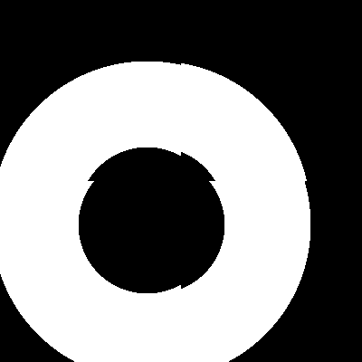
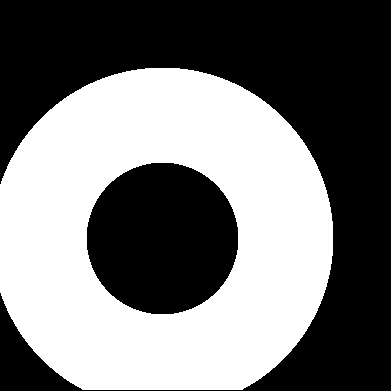
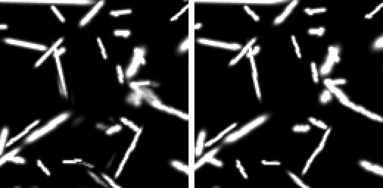
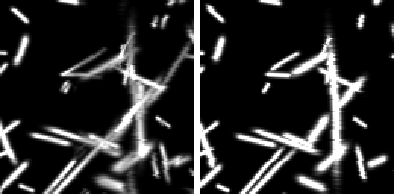
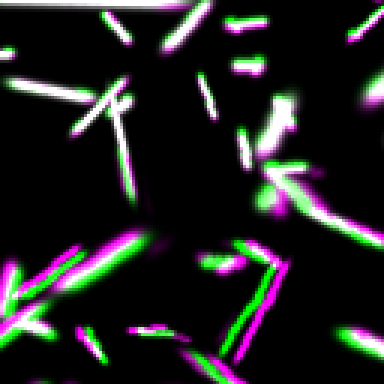
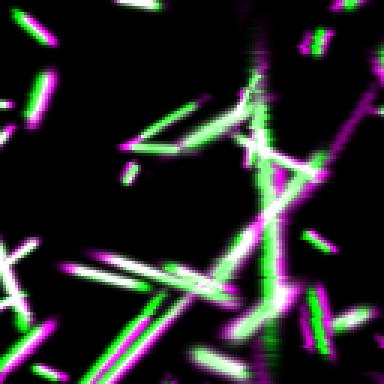

<h1>WobblyStitcher</h1>

<h2>Introduction</h2>

A scalable, out-of-memory, barebones implementation
of <a href="https://christophkirst.github.io/ClearMap2Documentation/html/wobblystitcher.html#wobblystitcher">WobblyStitcher</a>

<h2>Dependencies</h2>

<pre>
$ python3 -m pip install --no-deps numpy scikit-image scipy
</pre>

<h2>Install</h2>

<pre>
$ make
</pre>

<h2>Visualization</h2>

<a href="https://imagej.nih.gov">ImageJ</a>

<h2>Getting started</h2>

Generate four files with fake input
<pre>
$ (cd tool && make)
$ tool/gen -p 1 -n 200 200 200 -o 15 15
$ ls -1 *.raw
200x200x200le.00.00.raw
200x200x200le.00.01.raw
200x200x200le.01.00.raw
200x200x200le.01.01.raw
</pre>

stitch
<pre>
$ python3 main.py
main.py: processes = 4
386x388x203le.raw
386x388.pgm
</pre>

Open <tt>386x388x203le.raw</tt> in ImageJ.

<h2>Options</h2>

<pre>
$ python3 main.py -h
usage: main.py [-h] [-n X Y Z] [-t X Y] [-o X Y] [-s X Y Z] [-m M] [-w A B]
               [-p P] [-v]
               [path ...]

stitch a grid of raw tiles

positional arguments:
  path      tiles in x-major order, default: output of tool/gen

options:
  -h        show this help message and exit
  -n X Y Z  tile size (default: 200 200 200)
  -t X Y    number of tiles (default: 2 2)
  -o X Y    overlap (default: 15 15)
  -s X Y Z  stride (default: 1 1 1)
  -m M      maximum shift (default: 20)
  -w A B    smoothing windows of shifts and wobble in slices (default: 10 6)
  -p P      number of processes (default: 4)
  -v        verbose
</pre>

<h2>Wobbly example</h2>

Generate four tiles with vessels and a 30 pixel overlap. Every tile
except the first wobbles in x and y along z.
<pre>
$ tool/gen -p 3 -n 200 200 200 -o 30 30 -w 6
$ python3 main.py -o 30 30 -m 12
$ python3 img.py
img.py: img/wobble.xy.png img/merge.xy.png
img.py: img/wobble.xz.png img/merge.xz.png
</pre>

Center of the stitched volume where the four tiles meet: rigid
alignment (left) and wobbly alignment (right). Top view

side view

ImageJ style merge: rigid in magenta, wobbly in green, white where
they agree. Top view and side view

 

<h2>Tests</h2>

<pre>
$ python3 -m pip install pytest
$ python3 -m pytest
</pre>

<h2>Similar programs</h2>

<a href="https://imagej.net/plugins/bigstitcher">BigStitcher</a> 
<a href="https://abria.github.io/TeraStitcher">TeraStitcher</a> 
<a href="https://clearanatomics.github.io/ClearMapDocumentation">ClearMap</a>

<h2>References</h2>

1. Kirst, C., Skriabine, S., Vieites-Prado, A., Topilko, T., Bertin,
P., Gerschenfeld, G., ... & Renier, N. (2020). Mapping the fine-scale
organization and plasticity of the brain vasculature. Cell, 180(4),
780-795.
